# DE Billing — German invoicing for ERPNext

A Frappe custom app that turns ERPNext into the financial back end for a German contractor whose
day-to-day work happens in a separate office app (Supabase / React). The office app drives ERPNext
through a REST API and gets told about everything that happens through signed webhooks. Office staff
never need to open ERPNext. No ERPNext core files are touched; everything lives in this app.

**What it covers**

- **German base setup on SKR03**: the accounts ERPNext's SKR03 chart lacks (1710/1711/1718
  received down payments, 8125, 8337, 8338), tax categories and tax rules for domestic, § 13b
  reverse charge and EU sales, revenue-account mapping per tax treatment and VAT rate, and number
  series RE / AR / SR / RK for invoices and AB for orders.
- **Down-payment and final invoices** (Abschlags- und Schlussrechnungen) that reconcile to the cent.
  The final invoice deducts what was actually received on each down-payment invoice, net and VAT
  separately. Unpaid down payments are closed automatically, so they are never dunned. The same down
  payment can never be deducted twice. The prepaid amount is ready for BT-113 in ZUGFeRD / XRechnung.
- **REST API** keyed on Supabase IDs, with idempotent writes and an OpenAPI spec.
- **Signed webhooks** for invoice, credit-note and payment events, stored in an outbox and retried
  with backoff.
- **German invoice layout** (DIN 5008 style) with the legal notes each case needs (§ 13b,
  § 4 Nr. 1b, § 14b, Leitweg-ID).
- **33 automated tests**, including the full down-payment arithmetic checked against the general ledger.

Tested on ERPNext 15.124 / Frappe 15.125, MariaDB 10.6.

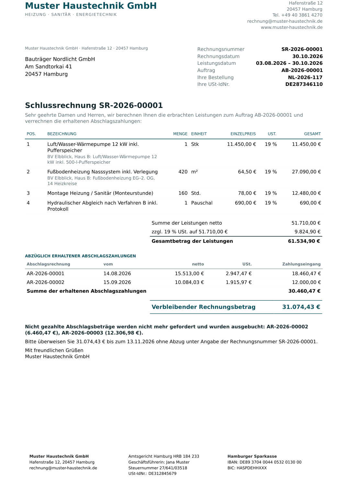

---

## Contents

1. [Down payments and final invoices](#1-down-payments-and-final-invoices)
2. [Tax treatments and SKR03 accounts](#2-tax-treatments-and-skr03-accounts)
3. [REST API](#3-rest-api)
4. [Webhooks](#4-webhooks)
5. [Invoice layout](#5-invoice-layout)
6. [Installation](#6-installation)
7. [Tests](#7-tests)
8. [Project structure](#8-project-structure)
9. [Scope and next steps](#9-scope-and-next-steps)

---

## 1. Down payments and final invoices

### Booking model

| Document | Rows | Booked to |
|---|---|---|
| **Down-payment invoice** (AR) | one down-payment row (net) + VAT | liability *1718 Erhaltene, versteuerte Anzahlungen 19 %* (1711 for 7 %, 1710 without VAT) and output VAT |
| **Final invoice** (SR) | all services of the order at full value | revenue (8400 / 8300 / 8337 …) and output VAT on the full amount |
| | − one row per down payment **received** | back against the liability account, 0 % item tax |
| | − VAT contained in the received amount | explicit tax row per VAT account |
| **Correction invoice** (RK), created on submit of the final invoice | unpaid part of each down-payment invoice | credit note against that down-payment invoice: closes it in the liability and VAT accounts and sets its outstanding to 0 |

The VAT on the final invoice is therefore exactly *VAT on the services − VAT already invoiced on the
received down payments*, and the amount due is exactly *gross services − gross received*. There is no
rounding drift, because the VAT on deductions is taken from the down-payment invoices themselves (pro
rata per VAT account for partial payments) instead of being recalculated.

### Worked example (seed data, order AB-2026-00001)

Services: heat pump, 420 m² underfloor heating, 160 h assembly, hydraulic balancing =
**51,710.00 net + 9,824.90 VAT = 61,534.90**.

| Down payment | Invoiced (gross) | Received | Deducted net | Deducted VAT | Unpaid → closed by |
|---|---:|---:|---:|---:|---|
| AR-2026-00001 (30 %) | 18,460.47 | 18,460.47 | 15,513.00 | 2,947.47 | – |
| AR-2026-00002 (30 %) | 18,460.47 | 12,000.00 | 10,084.03 | 1,915.97 | 6,460.47 → RK-2026-00001 |
| AR-2026-00003 (20 %) | 12,306.98 | 0.00 | 0.00 | 0.00 | 12,306.98 → RK-2026-00002 |

Final invoice **SR-2026-00001**: 61,534.90 − 30,460.47 received = **31,074.43 due**
(26,112.97 net + 4,961.46 VAT). Afterwards account 1718 is back to zero for this order:

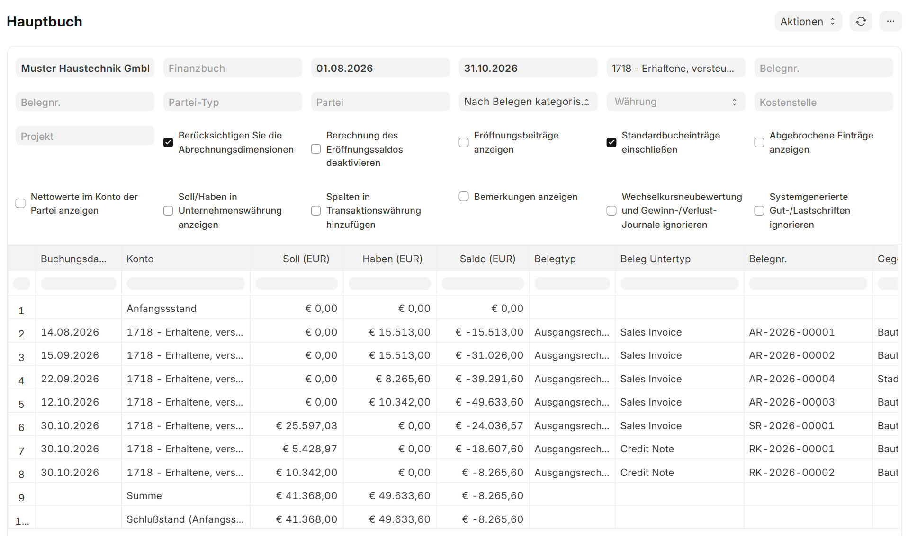

*Account 1718 over the period: the Nordlicht down payments (AR-1/2/3) are fully released by the final
invoice and the two correction invoices. The remaining 8,265.60 is the down payment of a second order
whose final invoice is still a draft.*

| | |
|---|---|
| 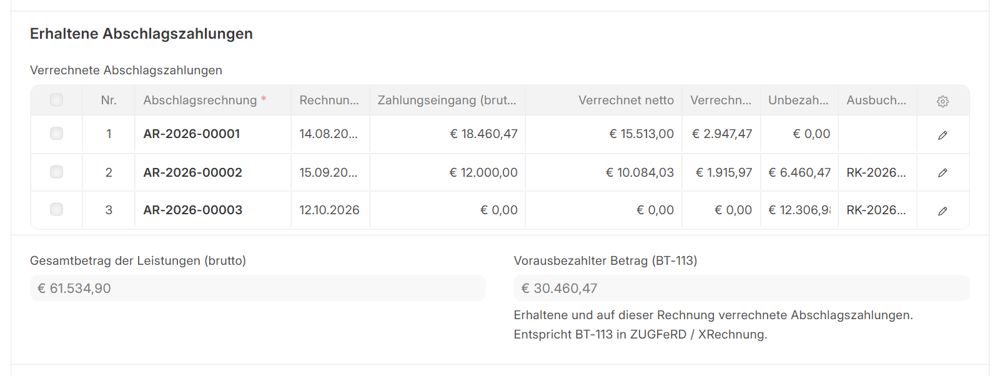 | 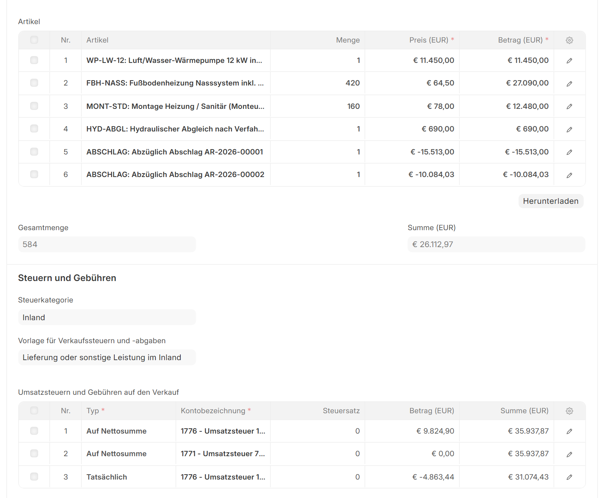 |

### Rules enforced

- Only payments **actually received** count: payment entries and journal entries allocated to the
  down-payment invoice. Credit notes don't count.
- Deductions are recalculated on every save and **again on submit**, so a payment that arrives after
  the draft was created is still picked up.
- **No double deduction**: a down-payment invoice that a submitted final invoice has already deducted
  is skipped. Concurrent submissions for the same order are serialised with a row lock.
- A deducted down-payment invoice **cannot be cancelled**. Cancelling the final invoice first
  cancels the correction invoices and reopens the down payments.
- If the down payments received exceed the services on a final invoice, it is rejected with a clear
  message instead of ERPNext's generic "grand total must be >= 0".
- A down-payment invoice takes the VAT rate of its order. Orders with mixed rates must set it per row.

## 2. Tax treatments and SKR03 accounts

The customer's tax category selects the sales tax template (via Tax Rules) and the revenue account:

| Tax treatment (API) | Tax category | ERPNext template | Revenue account | Note printed |
|---|---|---|---|---|
| `domestic` | Inland | Lieferung oder sonstige Leistung im Inland | 8400 (19 %), 8300 (7 %) | – |
| `reverse_charge_13b` | § 13b UStG | Bauleistungen nach § 13b UStG | 8337 | Steuerschuldnerschaft des Leistungsempfängers gemäß § 13b UStG |
| `eu_goods` | EU-Lieferung | Lieferung an Unternehmen in der EU | 8125 | Steuerfreie innergemeinschaftliche Lieferung gemäß § 4 Nr. 1b UStG |
| `eu_services` | EU-Leistung | Sonstige Leistung an Unternehmen in der EU | 8338 | Reverse Charge, Art. 196 MwStSystRL |

The app builds on the tax templates and item tax templates (19 % / 7 % / 0 %) that ERPNext's German
setup already creates. It adds what is missing:

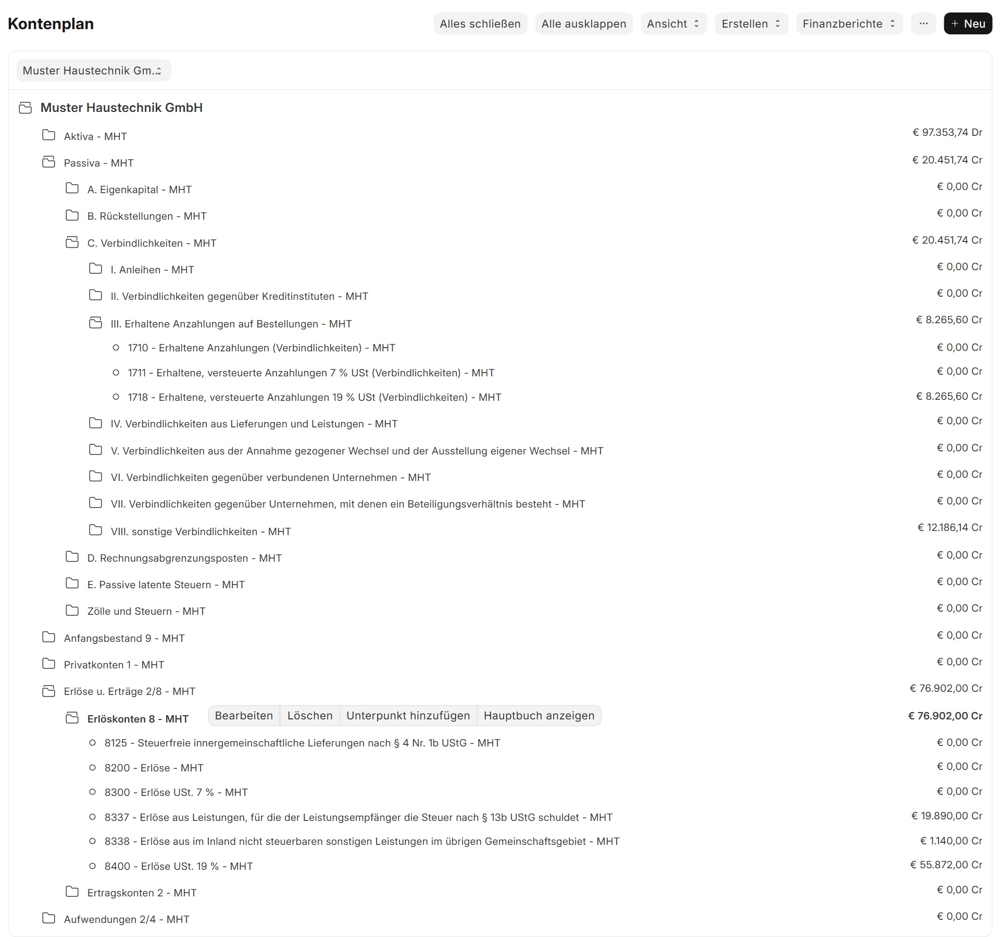

- Accounts **1710 / 1711 / 1718**, **8125**, **8337** and **8338**, created under the right
  SKR03 groups for every German SKR03 company, including companies created later.
- **Tax categories and tax rules** for the four treatments above.
- **Item tax rows per tax category.** ERPNext only applies an item tax template whose tax category
  matches the transaction exactly, so a generic VAT row on an item is copied to every category.
- **Customer fields**: Supabase ID, customer kind (business / private / public authority) and
  **Leitweg-ID**, which is validated and required for public-sector customers (BT-10 in XRechnung).

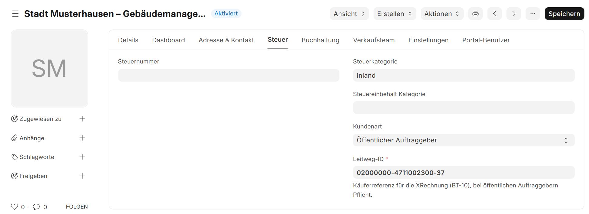

## 3. REST API

All endpoints are `/api/method/de_billing.api.v1.<name>`, authenticated with the API key of a
dedicated integration user (`Authorization: token <key>:<secret>`). Full spec:
[`docs/openapi.yaml`](docs/openapi.yaml).

| Endpoint | Purpose |
|---|---|
| `upsert_customer` | create / update the ERPNext copy of a customer, keyed on `supabase_id` (address, contact, tax treatment, Leitweg-ID) |
| `upsert_item` | create / update an item, its VAT rate and selling price |
| `create_order` | create and submit a sales order (idempotent on `supabase_id`) |
| `create_invoice` | standard, down-payment (`amount` or `percent`) or final invoice (idempotent on `idempotency_key`) |
| `get_invoice` | status, totals, outstanding amount and deductions, by name or `supabase_id` |
| `get_invoice_pdf` | the invoice as PDF (German layout), base64 |
| `record_payment` | book an incoming payment against an invoice |

```bash
curl -X POST https://erp.example.com/api/method/de_billing.api.v1.create_invoice \
  -H "Authorization: token $API_KEY:$API_SECRET" -H "Content-Type: application/json" \
  -d '{"idempotency_key": "office-app-7f3c2a", "customer": "c_weber", "kind": "standard",
       "items": [{"item": "i_wart", "qty": 1}, {"item": "i_mont", "qty": 2}]}'
```

Output of the same call made twice against the running system, then a bad request and a request
without a token:

```
call 1: HTTP 200  name=RE-2026-00005 grand_total=410.55 replayed=False
call 2: HTTP 200  name=RE-2026-00005 grand_total=410.55 replayed=True
bad kind: HTTP 417 {"message": "kind must be one of: standard, down_payment, final.", ...}
no token: HTTP 403
```

`get_invoice` for the final invoice above (abridged):

```json
{
  "name": "SR-2026-00001", "kind": "final", "status": "Unpaid",
  "customer_supabase_id": "c_nordlicht", "order": "AB-2026-00001",
  "net_total": 26112.97, "total_taxes": 4961.46, "grand_total": 31074.43,
  "total_before_deductions": 61534.9, "prepaid_amount": 30460.47,
  "deductions": [
    {"down_payment_invoice": "AR-2026-00001", "received": 18460.47, "net": 15513.0, "vat": 2947.47, "unpaid_closed": 0.0},
    {"down_payment_invoice": "AR-2026-00002", "received": 12000.0, "net": 10084.03, "vat": 1915.97, "unpaid_closed": 6460.47, "closing_document": "RK-2026-00001"},
    {"down_payment_invoice": "AR-2026-00003", "received": 0.0, "net": 0.0, "vat": 0.0, "unpaid_closed": 12306.98, "closing_document": "RK-2026-00002"}
  ]
}
```

## 4. Webhooks

Events: `invoice.submitted`, `invoice.cancelled`, `invoice.paid`, `credit_note.submitted`,
`credit_note.cancelled`, `payment.received`, `payment.cancelled`.

- **Outbox**: every event is first stored as a *Webhook Delivery* document in the same transaction as
  the business change, then delivered right after commit. If ERPNext rolls back, nothing is sent.
- **Signature**: `X-Webhook-Signature: sha256=HMAC_SHA256(secret, "<X-Webhook-Timestamp>.<raw body>")`,
  plus `X-Webhook-Id` (event id for de-duplication) and `X-Webhook-Event`.
- **Retries**: failed deliveries (non-2xx or network error) are retried by the scheduler after 1, 2,
  4, 8 … minutes (capped at 6 h). After *Max Attempts* the delivery is marked *Failed* and can be
  resent with one click. Delivery is at-least-once.
- [`tools/webhook_receiver.py`](tools/webhook_receiver.py) is a reference receiver (standard library only)
  that verifies the signature, rejects stale timestamps and drops duplicates. Its logic maps one-to-one
  onto a Supabase Edge Function.

```
$ WEBHOOK_SECRET=... python tools/webhook_receiver.py --port 8787
listening on :8787
16:01:02  signature ok  invoice.paid           RE-2026-00004            2,589.44 EUR
16:01:02  signature ok  payment.received       ACC-PAY-2026-00006       2,589.44 EUR
```

| | |
|---|---|
| 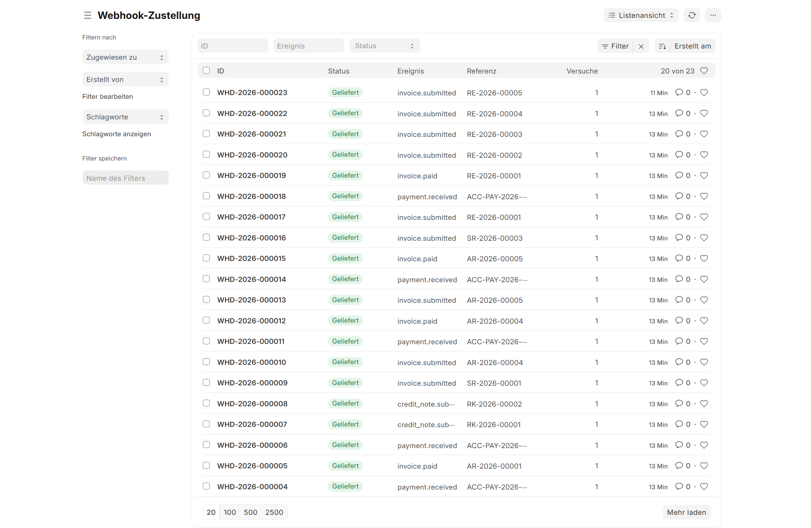 | 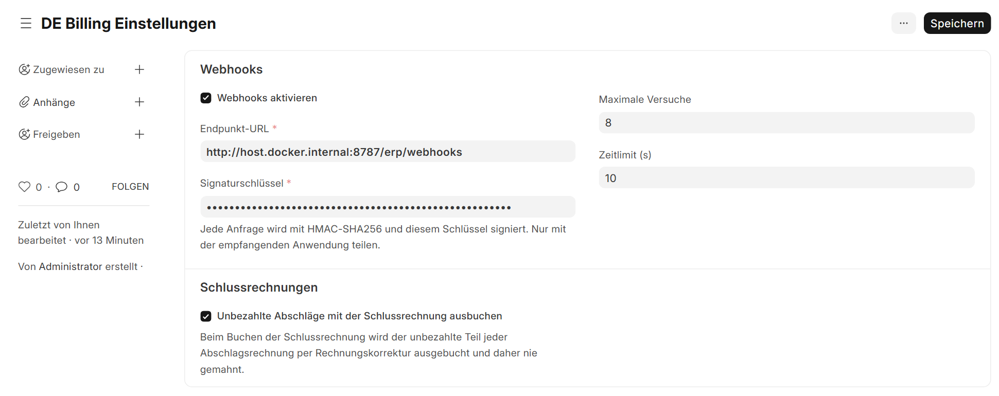 |

## 5. Invoice layout

Print format **Rechnung DE** (default for Sales Invoice) produces Rechnung, *n*. Abschlagsrechnung,
Schlussrechnung and Rechnungskorrektur from one template. It includes the § 14 UStG details (service
date or period, the customer's VAT ID, order reference), VAT broken down by rate, the deduction table on
final invoices, the legal note for the tax treatment, the two-year retention note for private customers
(§ 14b), and the Leitweg-ID for public-sector customers. Invoice texts are always German, whatever the
language of the API user.

Sample PDFs generated by the API: [`docs/samples/`](docs/samples)

| Final invoice, § 13b | Correction invoice | Down-payment invoice |
|---|---|---|
| 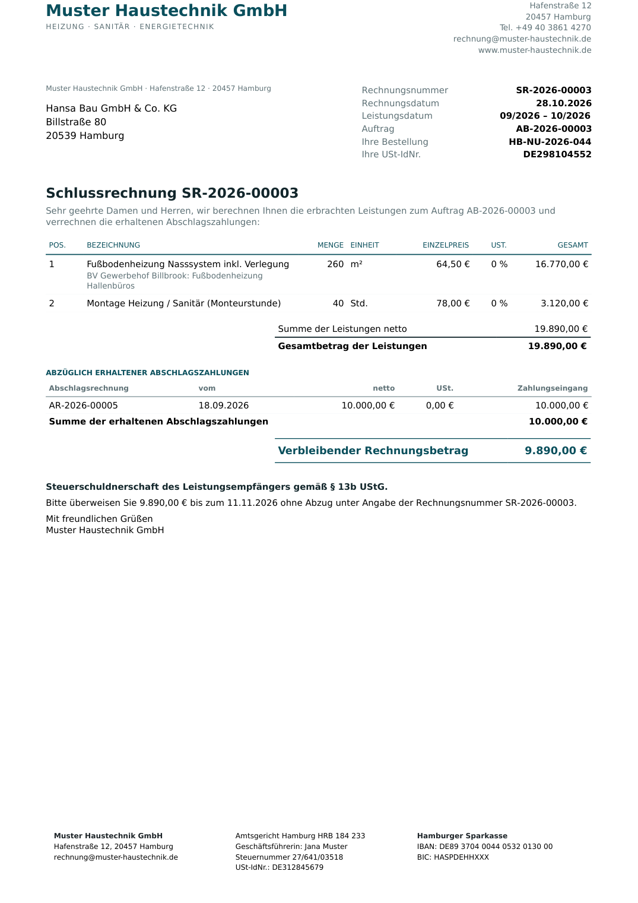 | 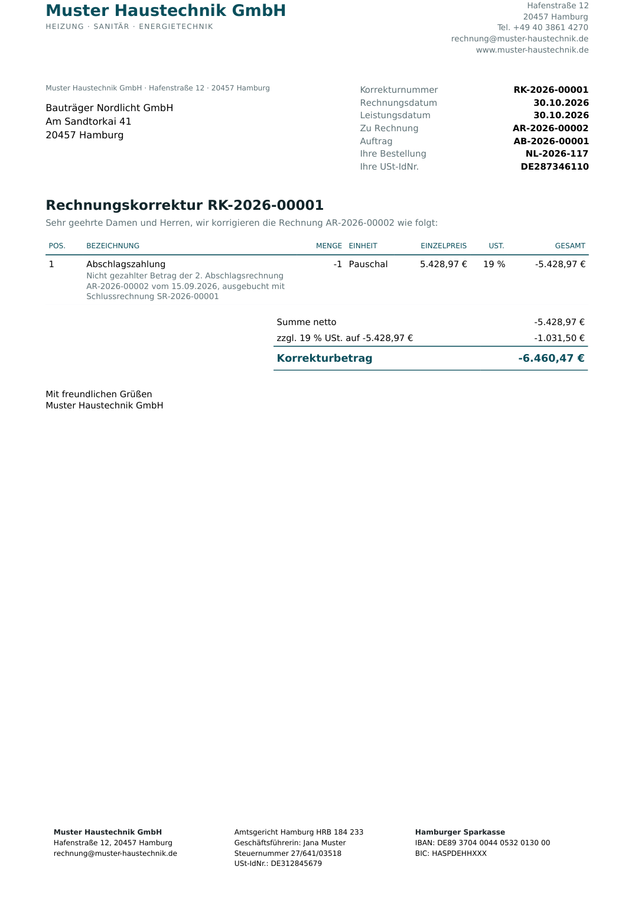 | 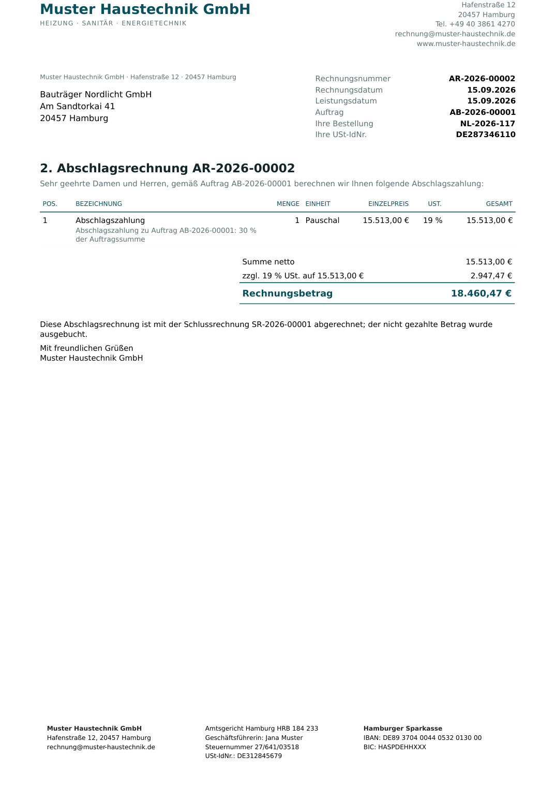 |

## 6. Installation

```bash
cd frappe-bench
bench get-app https://github.com/dimitrovdaniel/erpnext-de-billing
bench --site <site> install-app de_billing
```

Installing on a site with a German SKR03 company sets that company up right away; companies created
later are set up as soon as ERPNext has built their chart of accounts. Optional seed data for a
fictional company (orders, down-payment chains, payments, final invoices, all created through the API):

```bash
bench --site <site> execute de_billing.setup.sample_data.create --kwargs "{'company': '<company>'}"
```

**ERPNext settings the app changes** (all standard settings, listed for transparency):

| Setting | Value | Why |
|---|---|---|
| Global Defaults → Disable Rounded Total | on | German invoices show exact amounts |
| Selling Settings → Allow Negative Rates for Items | on | final invoices deduct down payments as negative rows (ERPNext rejects negative quantities) |
| Accounts Settings → Add Taxes from Item Tax Template | off | VAT rows come from the sales tax template; otherwise ERPNext would add VAT to § 13b and EU invoices |

Webhooks are configured in **DE Billing Settings** (endpoint, signing secret, attempts, timeout).

## 7. Tests

```bash
bench --site <test-site> set-config allow_tests true
bench --site <test-site> run-tests --app de_billing
```

```
Ran 33 tests in 36.475s

OK
```

| Suite | What it proves |
|---|---|
| `test_down_payments` | down-payment booking (1718 / VAT, not revenue); all down payments paid; one partly paid (319.33 / 1,680.67 split, correction invoice of 1,570.00); one unpaid (closed, not deducted), each checked against the general ledger (1718 = 0, VAT = 19 % of the services, revenue = services); late payment picked up on submit; no double deduction; cancel reopens; deducted down payment cannot be cancelled; over-deduction rejected |
| `TestTaxTreatments` | § 13b (no VAT, 8337, 1710), EU services (8338), revenue split 8400 / 8300 by rate, mixed-rate orders |
| `test_api` | idempotent upserts and invoice creation, Leitweg-ID rule, down payment by percent, payments, PDF, error cases |
| `test_webhooks` | event creation, HMAC signature, retry with backoff, give-up after max attempts, no duplicate send, payment events |
| `test_setup` | a new German SKR03 company gets the extra accounts, 0 % item tax template, default revenue account and tax rules automatically |
| `test_printing` | final-invoice layout values, closed down payments, VAT shown on correction invoices, legal notes |

Code style: `ruff check` and `ruff format` (Frappe conventions, tabs).

## 8. Project structure

```
de_billing/
├── api/v1.py                  REST endpoints
├── billing/
│   ├── invoice.py             down-payment / final invoice logic, closing correction invoices
│   ├── accounts.py            VAT rate, revenue and down-payment account resolution
│   ├── printing.py            context for the German print format
│   ├── customer.py            Leitweg-ID validation
│   └── item.py                item tax rows per tax category
├── webhooks/                  outbox, signing, delivery and retries, event hooks, payloads
├── setup/                     install hooks, custom fields, SKR03 / tax setup, seed data
├── de_billing/doctype/        Down Payment Deduction, Webhook Delivery, DE Billing Settings
├── de_billing/print_format/   Rechnung DE
├── templates/print/           invoice template (Jinja)
├── translations/de.csv        German UI labels
└── tests/
docs/openapi.yaml, docs/samples/*.pdf, docs/screenshots/
tools/webhook_receiver.py
```

## 9. Scope and next steps

This app covers the base setup, down-payment / final invoicing, the API and webhook layer, and the
invoice layout. It does not include:

- **E-invoice output (ZUGFeRD / XRechnung).** Intended to come from `eu_einvoice`. This app already
  provides the values the mapping needs: the prepaid amount (BT-113), the Leitweg-ID (BT-10) and the
  customer kind.
- **DATEV export and the GoBD process documentation.** Intended to come from `erpnext_datev`. The
  revenue accounts above are what a DATEV export keys tax codes on.
- **Bank import and reconciliation**, and **dunning** beyond ERPNext's standard. Closed down payments
  already have outstanding 0, so standard dunning never picks them up.

## License

MIT
